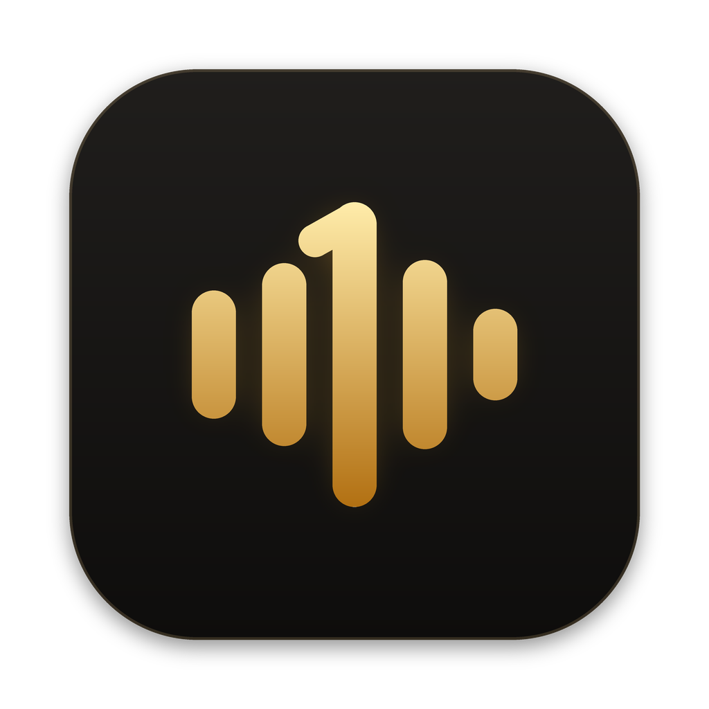

<p align="center">
  
</p>

<h1 align="center">MainMic</h1>

<p align="center">
  <a href="https://buymeacoffee.com/eastwoodsee"></a>
</p>

A small menu bar app for macOS (built for the MacBook Air M4) that picks your microphone for you, so AirPods
or any other headset can't take over the input when they connect.

- **Priority list.** The highest-ranked mic that's connected becomes the system input. The MacBook's built-in
  microphone starts at the top. Any new device (AirPods, USB mic, webcam…) goes in at the **bottom** the first
  time it's seen, so it can't take over unless you move it up.
- **Remembers devices.** Devices are stored by their Core Audio UID, so unplugging and replugging, Bluetooth
  reconnects and reboots all keep the order you set.
- **Holds the setting.** MainMic reacts to every device and default-input change, checks again several times over
  the next 6 seconds (AirPods often grab the input again a second or two after connecting), re-checks after
  wake, and runs a check every 3 seconds as a fallback.
- **Better AirPods audio.** With the built-in mic as input, AirPods stay in high-quality stereo for output
  instead of dropping to the low-quality "headset" call profile.

## Menu

Click the MainMic icon (five level bars, the middle one a "1" with a base) in the menu bar:

| Item | What it does |
| --- | --- |
| MainMic 1.2.1 | The installed version |
| Up to date / Update Available: … | Whether a newer release is on GitHub. Click **Update Available** to open the release page |
| Input: … | The current system input |
| Last fix: … | The last time MainMic switched the input back, and from which device |
| 1. MacBook Air Microphone ✓ | The priority list. The check mark is the active device. Hover over a device for **Make Top Priority / Move Up / Move Down / Move to Bottom / Never Use This Mic / Forget Device** |
| Pause Auto-Switching | Stops enforcing the list for now (the bars flatten to dots) |
| Launch at Login | Starts MainMic when you log in. Turned on automatically at first launch; uncheck to turn it off (also listed under System Settings → General → Login Items) |
| Check for Updates | Checks GitHub now (MainMic also checks at launch and every few hours) |

To use your AirPods mic for a call, choose **AirPods → Make Top Priority**. When you're done, move the MacBook mic
back to the top, or just pause auto-switching. If you change the input in System Settings or Control Center while
MainMic is running, it will switch it straight back. That's on purpose.

## Install

**Option 1: Terminal (one line).** Paste this into Terminal:

```bash
curl -L https://github.com/seastwood/mainmic/releases/latest/download/MainMic.zip -o /tmp/MainMic.zip && ditto -x -k /tmp/MainMic.zip /Applications && xattr -dr com.apple.quarantine /Applications/MainMic.app && open /Applications/MainMic.app
```

**Option 2: Download.**

1. Download **[MainMic.dmg](https://github.com/seastwood/mainmic/releases/latest/download/MainMic.dmg)** from the
   [latest release](https://github.com/seastwood/mainmic/releases/latest).
2. Open it and drag **MainMic** onto the **Applications** shortcut.
3. The app isn't signed by Apple, so open Terminal once and run:
   ```bash
   xattr -dr com.apple.quarantine /Applications/MainMic.app
   ```
4. Open MainMic. The MainMic level-bars icon appears in the menu bar. It starts at login automatically.

When a new version is out, the menu shows **Update Available**. To update, follow the same steps again (quit MainMic from its menu first). Your priority list is kept.

**Build from source.** You need the Xcode Command Line Tools (`xcode-select --install`):

```bash
git clone https://github.com/seastwood/mainmic.git && cd mainmic && ./build.sh --install
```

MainMic doesn't need microphone permission. It only changes which device is the default input and never records
audio.

## Releasing

Run the **Release** workflow from the Actions tab (Run workflow → enter a version like `v1.0.1`), or push a tag
(`git tag v1.0.1 && git push origin v1.0.1`). The workflow sets the app version from the tag, builds the app, creates
the tag and publishes `MainMic.dmg` and `MainMic.zip` to GitHub Releases. If you create the release by hand on GitHub instead, the
workflow attaches both files to it. The optional **notes** input sets the release notes. To build the disk image locally, run
`./build.sh --dmg`.

## App icon

The app icon is drawn by `scripts/make_icon.py` and the menu bar icon by `Sources/MainMic/Glyph.swift`. Both use the
same bar geometry, so change them together. Run `python3 scripts/make_icon.py` (needs Pillow) to regenerate
`Resources/AppIcon.icns`.

## Logs

```bash
log stream --predicate 'subsystem == "com.seastwood.mainmic"' --level info
```

## Support

If MainMic saves you from AirPods hijacking your mic, you can [buy me a coffee](https://buymeacoffee.com/eastwoodsee).
